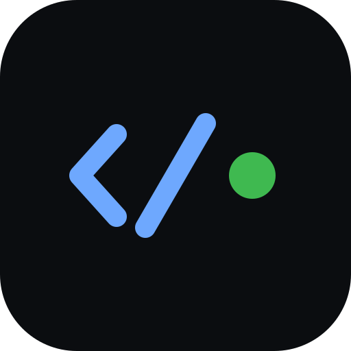

<p align="center">
  
</p>

<p align="center">
  
  &nbsp;
  
  &nbsp;
  
</p>

<h1 align="center">dshrc</h1>

<p align="center">
  <b>Remote control for DeepSeek Harness.</b><br>
  Drive your <code>dsh</code> coding agent from your phone — over ACP, not a screen scrape.
</p>

<p align="center">
  <a href="#-features">Features</a> ·
  <a href="#-install">Install</a> ·
  <a href="#-quickstart">Quickstart</a> ·
  <a href="#-news">News</a> ·
  <a href="#-whats-next">What's next</a> ·
  <a href="docs/GUIDE.md">Guide</a> ·
  <a href="docs/ARCHITECTURE.md">Architecture</a>
</p>

<p align="center">
  <a href="https://github.com/sandeep-alluru/deepseek-harness-rc/actions/workflows/ci.yml"></a>
  <a href="LICENSE"></a>
  
  <a href="https://www.npmjs.com/package/dshrc"></a>
</p>

> **Not affiliated with or endorsed by DeepSeek.** dshrc is an independent, unofficial
> client that talks to [DeepSeek Harness](https://github.com/deepseek-ai/deepseek-harness)
> (`dsh`) over the [Agent Client Protocol](https://agentclientprotocol.com), via the
> community adapter [`deepseek-acp`](https://www.npmjs.com/package/deepseek-acp).

---

## 📰 News

- **2026-09-05 — dshrc 0.1.0.** First release: pair a phone with a short-lived code,
  start and drive `dsh` sessions over ACP, approve tool calls with one tap, receive
  self-hosted push notifications, and reach the daemon over LAN, Tailscale, or an
  outbound relay. A terminal client and an Even Realities G2 glasses client are
  included. Full notes in the [Changelog](CHANGELOG.md).

---

## ⚡ Get started

```bash
# 1. deepseek-acp — the ACP adapter dshrc drives (unofficial; wraps DeepSeek Harness)
npm install -g deepseek-acp
deepseek-acp --setup        # paste a DeepSeek API key once, or export DEEPSEEK_API_KEY

# 2. dshrc
npm install -g dshrc

# 3. One required setting — where new sessions open
dshrc config set defaultCwd ~/code

# 4. Start
dshrc up --lan
```

Open the printed URL on your phone, enter the 6-character code, add to Home Screen.

```
  dshrc listening on http://192.168.1.10:4319

  No paired devices. Open the URL above and enter:

      Y8M8GF
```

(`192.168.1.10` is an example — use the address your machine prints.)

Approvals need no extra setup: `deepseek-acp`'s sandbox **always** asks before a tool
touches anything outside the session's working directory, so one-tap remote approval
just works out of the box.

For **access from anywhere** (cellular, travel), use **Tailscale** so the phone gets
HTTPS on your private tailnet — see [Guide → Tailscale](docs/GUIDE.md#tailscale-access-from-anywhere).

Check the install anytime: `dshrc doctor`

---

## ⭐ Features

|                         | Existing tools       | dshrc                                  |
| ----------------------- | --------------------- | --------------------------------------- |
| Transport                | PTY / terminal bytes | **ACP JSON-RPC** (typed)                |
| Waiting for you?         | Regex over ANSI      | `session/request_permission` — **always sent**, no config bypass |
| Approve a tool           | Send keystrokes      | One tap by `optionId`                   |
| Networking               | Open inbound ports   | LAN, Tailscale, or **outbound relay**   |
| Terminal + phone         | Separate sessions    | **Same session** (`dshrc term`)         |
| Platforms                | Often iOS-only       | **PWA** — iOS and Android               |
| DeepSeek Harness         | Unsupported          | **Native**, via `deepseek-acp`          |

- **Owned sessions** — start from the phone; full control
- **Push notifications** — self-hosted Web Push (VAPID); no third-party cloud
- **Relay mode** — daemon dials out; nothing listens on your machine
- **Glasses client** — an [Even Realities G2](glasses/README.md) front end to the same daemon

Full usage: **[docs/GUIDE.md](docs/GUIDE.md)**

---

## 📥 Install

Requires **Node 20+** and [`deepseek-acp`](https://www.npmjs.com/package/deepseek-acp)
(itself a wrapper over [DeepSeek Harness](https://github.com/deepseek-ai/deepseek-harness)).

```bash
npm install -g deepseek-acp
npm install -g dshrc
```

From source:

```bash
git clone https://github.com/sandeep-alluru/deepseek-harness-rc.git
cd deepseek-harness-rc
npm install && npm run build
npm link
```

| Platform    | Packaged CLI | Full suite (CI) | Service           |
| ----------- | ------------ | ---------------- | ----------------- |
| **Linux**   | Node 20–24   | Node 22, 24      | systemd user unit |
| **macOS**   | Node 20–24   | Node 22, 24      | —                  |
| **Windows** | Node 20–24   | Node 22, 24      | Scheduled Task     |

Verified against `deepseek-acp` 0.8.0.

---

## 🚀 Quickstart

```bash
dshrc config set defaultCwd ~/code   # required
dshrc doctor                         # agent, ACP, approvals
dshrc up --lan                       # reachable on your LAN
```

| Goal                     | Command                                                |
| ------------------------ | ------------------------------------------------------- |
| Pair another device      | `dshrc pair`                                            |
| List devices             | `dshrc devices`                                         |
| Revoke a device          | `dshrc revoke <id>`                                     |
| Terminal on same session | `dshrc term`                                            |
| Run as a service (Linux) | see [Guide → Service](docs/GUIDE.md#run-as-a-service)   |
| Outbound relay           | `dshrc up --relay wss://your-relay`                     |
| Use a different agent binary | `dshrc up --agent-command /path/to/deepseek-acp`   |

---

## 📱 Reach your phone

1. **LAN** — `dshrc up --lan` on a trusted Wi‑Fi only
2. **Tailscale (recommended)** — install Tailscale on PC + phone, then:
   `sudo tailscale set --operator=$USER`
   `tailscale serve --bg http://127.0.0.1:4319`
   Open the printed `https://your-machine.tail-xxxx.ts.net` URL (sample shape only)
3. **Relay** — daemon dials **out** to a VPS you control

Step-by-step Tailscale setup (install, Serve, pair, persist, troubleshooting):
**[Guide → Tailscale](docs/GUIDE.md#tailscale-access-from-anywhere)**

---

## How it works

dshrc spawns [`deepseek-acp`](https://www.npmjs.com/package/deepseek-acp) directly over
stdio — no subcommand or mode flags, since any argv it doesn't recognize as
`--setup`/`--version`/`--help` falls through to running as an ACP service. The daemon,
ACP client, pairing, push, relay, and phone/PWA/glasses clients all speak the same typed
protocol regardless of which agent is on the other end of the pipe, so the whole stack
above the transport layer never has to know or care that the agent is `deepseek-acp`.

A few things worth knowing about how this backend behaves:

- **Model selection** goes through the `DEEPSEEK_ACP_MODEL` environment variable —
  `deepseek-acp` has no `--model` CLI flag of its own.
- **Approvals are structurally guaranteed.** `deepseek-acp`'s sandbox always sends
  `session/request_permission` before a tool leaves the session's working directory —
  there is no config key, flag, or environment variable that turns it off. There is no
  state a phone-controlled session can end up in where tools run unattended without the
  phone getting a say. See [SECURITY.md](SECURITY.md).
- **One process per session.** Every spawned session is its own `deepseek-acp`
  process — there is no shared-backend mode to configure. (`--leader` is accepted in
  config files for compatibility.)

## 🔭 What's next

The roadmap builds on dsh's own session store. Verified against real files: dsh
writes one compressed `session.jsonl.zstd` per session under `$DSH_HOME/sessions/` and
keeps no live-process registry. Three features build on that store, in order:

- **Session discovery** — list sessions started outside dshrc, from the store itself.
  The reader decompresses the zstd JSONL and reads the `type:"session"` header line and
  the later `session/title` event; the schema is documented in code comments in
  `src/daemon/session-manager.ts`.
- **Registry-checked take-over** — reclaim a session another process has open, with a
  "refuse to join a standalone owner" guard. `takeOver()` resumes today; the guard
  builds on a live-process registry to check against.
- **Observed mode** — mirror a session started by hand elsewhere, by tailing its
  compressed log with the same reader (`src/daemon/observer.ts`).

Session **resume of a session dshrc itself created** works today — `deepseek-acp` advertises
ACP's `loadSession` capability, and the on-disk existence check matches dsh's real
directory-naming scheme. PRs on any of the three are very welcome.

---

## 📚 Documentation

| Doc                                      | Contents                                                                |
| ----------------------------------------- | ------------------------------------------------------------------------ |
| **[Guide](docs/GUIDE.md)**               | Install, config, daily use, push, relay, service, troubleshooting, FAQ    |
| **[Architecture](docs/ARCHITECTURE.md)** | Topology, ACP, session modes, event model                                |
| **[Security](SECURITY.md)**              | Threat model, reporting                                                  |
| **[Contributing](CONTRIBUTING.md)**      | Dev setup, tests, PRs                                                    |
| **[Changelog](CHANGELOG.md)**            | Release notes                                                           |

---

## 🧩 Components & versions

| Component | Version | Role |
| --------- | ------- | ---- |
| **dshrc** | 0.1.0 (npm) | This package — daemon, phone PWA, terminal and glasses clients |
| **deepseek-acp** | 0.8.0 (verified) | The ACP adapter over DeepSeek Harness; dshrc spawns it over stdio |
| **DeepSeek Harness** (`dsh`) | upstream | The coding agent being driven |
| **Node.js** | 20–24 | Runtime |

---

## ✅ How the numbers are verified

- CI runs typecheck, lint, format check, build, and the full test suite on Linux,
  macOS, and Windows (Node 22 and 24) — see the badges above.
- The ACP surface is conformance-checked against recorded handshakes from the real
  backend (`docs/captures/`), and the README screenshots are generated from a live
  `deepseek-acp` session.
- `dshrc doctor` re-checks a live install — agent, ACP, approvals — on your machine.

---

## 🔒 Security in one line

Remote control of a coding agent **is** remote code execution. Pair devices, prefer Tailscale
or relay over open LAN — approvals need no extra configuration; the sandbox always asks.
See [SECURITY.md](SECURITY.md).

---

## 🙏 Credits

- [DeepSeek Harness](https://github.com/deepseek-ai/deepseek-harness) — the agent dshrc drives.
- [`deepseek-acp`](https://www.npmjs.com/package/deepseek-acp) — the ACP adapter dshrc spawns.
- [Agent Client Protocol](https://agentclientprotocol.com) — the typed protocol both sides speak.
- The G2 glasses voice/compose flow was informed by
  [ThatCrispyToast/g2-claude-remote](https://github.com/ThatCrispyToast/g2-claude-remote).

---

## 📖 Citation

```bibtex
@software{dshrc,
  title  = {dshrc: Remote control for DeepSeek Harness},
  author = {Alluru, Sandeep Varma},
  url    = {https://github.com/sandeep-alluru/deepseek-harness-rc},
  year   = {2026}
}
```

---

## License

[MIT](LICENSE).
