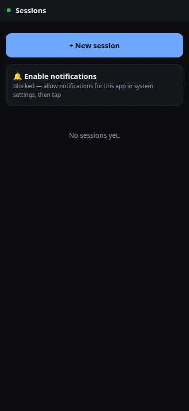
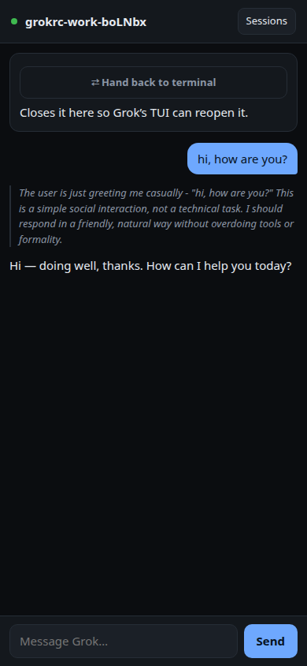
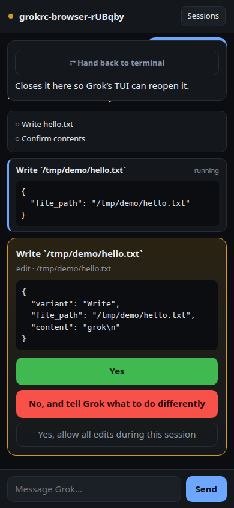

<p align="center">
  
  &nbsp;
  
  &nbsp;
  
</p>

<h1 align="center">dshrc</h1>

<p align="center">
  <b>Remote control for DeepSeek Harness.</b><br>
  Drive your <code>dsh</code> coding agent from your phone — over ACP, not a screen scrape.
</p>

<p align="center">
  <a href="#-features">Features</a> ·
  <a href="#-install">Install</a> ·
  <a href="#-quickstart">Quickstart</a> ·
  <a href="#why-the-fork">Why the fork</a> ·
  <a href="#known-gaps">Known gaps</a> ·
  <a href="docs/GUIDE.md">Guide</a> ·
  <a href="docs/ARCHITECTURE.md">Architecture</a>
</p>

<p align="center">
  <a href="https://github.com/sandeep-alluru/deepseek-harness-rc/actions/workflows/ci.yml"></a>
  <a href="LICENSE"></a>
  
  <a href="https://www.npmjs.com/package/dshrc"></a>
</p>

> **Not affiliated with or endorsed by DeepSeek.** dshrc is an independent, unofficial
> client that talks to [DeepSeek Harness](https://github.com/deepseek-ai/deepseek-harness)
> (`dsh`) over the [Agent Client Protocol](https://agentclientprotocol.com), via the
> community adapter [`deepseek-acp`](https://www.npmjs.com/package/deepseek-acp).

---

## ⚡ Get started

```bash
# 1. deepseek-acp — the ACP adapter dshrc drives (unofficial; wraps DeepSeek Harness)
npm install -g deepseek-acp
deepseek-acp --setup        # paste a DeepSeek API key once, or export DEEPSEEK_API_KEY

# 2. dshrc
npm install -g dshrc

# 3. One required setting — where new sessions open
dshrc config set defaultCwd ~/code

# 4. Start
dshrc up --lan
```

Open the printed URL on your phone, enter the 6-character code, add to Home Screen.

```
  dshrc listening on http://192.168.1.10:4319

  No paired devices. Open the URL above and enter:

      Y8M8GF
```

(`192.168.1.10` is an example — use the address your machine prints.)

Approvals need no extra setup here — unlike this project's Grok Build ancestor,
`deepseek-acp`'s sandbox **always** asks before a tool touches anything outside the
session's working directory, so one-tap approval just works. See [Why the fork](#why-the-fork).

For **access from anywhere** (cellular, travel), use **Tailscale** so the phone gets
HTTPS on your private tailnet — see [Guide → Tailscale](docs/GUIDE.md#tailscale-access-from-anywhere).

Check the install anytime: `dshrc doctor`

---

## ⭐ Features

|                         | Existing tools       | dshrc                                  |
| ----------------------- | --------------------- | --------------------------------------- |
| Transport                | PTY / terminal bytes | **ACP JSON-RPC** (typed)                |
| Waiting for you?         | Regex over ANSI      | `session/request_permission` — **always sent**, no config bypass |
| Approve a tool           | Send keystrokes      | One tap by `optionId`                   |
| Networking               | Open inbound ports   | LAN, Tailscale, or **outbound relay**   |
| Terminal + phone         | Separate sessions    | **Same session** (`dshrc term`)         |
| Platforms                | Often iOS-only       | **PWA** — iOS and Android               |
| DeepSeek Harness         | Unsupported          | **Native**, via `deepseek-acp`          |

- **Owned sessions** — start from the phone; full control
- **Push notifications** — self-hosted Web Push (VAPID); no third-party cloud
- **Relay mode** — daemon dials out; nothing listens on your machine
- **Glasses client** — an [Even Realities G2](glasses/README.md) front end to the same daemon

Full usage: **[docs/GUIDE.md](docs/GUIDE.md)** *(still describes the Grok Build ancestor in
places — being refreshed; the sections on pairing, push, relay, and the service unit are
backend-agnostic and accurate today)*

---

## 📥 Install

Requires **Node 20+** and [`deepseek-acp`](https://www.npmjs.com/package/deepseek-acp)
(itself a wrapper over [DeepSeek Harness](https://github.com/deepseek-ai/deepseek-harness)).

```bash
npm install -g deepseek-acp
npm install -g dshrc
```

From source:

```bash
git clone https://github.com/sandeep-alluru/deepseek-harness-rc.git
cd deepseek-harness-rc
npm install && npm run build
npm link
```

| Platform    | Packaged CLI | Full suite (CI) | Service           |
| ----------- | ------------ | ---------------- | ----------------- |
| **Linux**   | Node 20–24   | Node 22, 24      | systemd user unit |
| **macOS**   | Node 20–24   | Node 22, 24      | —                  |
| **Windows** | Node 20–24   | Node 22, 24      | Scheduled Task     |

Verified against `deepseek-acp` 0.8.0. Windows path-encoding for dsh session directories
is **unverified** on this platform — see [Known gaps](#known-gaps).

---

## 🚀 Quickstart

```bash
dshrc config set defaultCwd ~/code   # required
dshrc doctor                         # agent, ACP, approvals
dshrc up --lan                       # reachable on your LAN
```

| Goal                     | Command                                                |
| ------------------------ | ------------------------------------------------------- |
| Pair another device      | `dshrc pair`                                            |
| List devices             | `dshrc devices`                                         |
| Revoke a device          | `dshrc revoke <id>`                                     |
| Terminal on same session | `dshrc term`                                            |
| Run as a service (Linux) | see [Guide → Service](docs/GUIDE.md#run-as-a-service)   |
| Outbound relay           | `dshrc up --relay wss://your-relay`                     |
| Use a different agent binary | `dshrc up --agent-command /path/to/deepseek-acp`   |

---

## 📱 Reach your phone

1. **LAN** — `dshrc up --lan` on a trusted Wi‑Fi only
2. **Tailscale (recommended)** — install Tailscale on PC + phone, then:
   `sudo tailscale set --operator=$USER`
   `tailscale serve --bg http://127.0.0.1:4319`
   Open the printed `https://your-machine.tail-xxxx.ts.net` URL (sample shape only)
3. **Relay** — daemon dials **out** to a VPS you control

Step-by-step Tailscale setup (install, Serve, pair, persist, troubleshooting):
**[Guide → Tailscale](docs/GUIDE.md#tailscale-access-from-anywhere)**

---

## Why the fork

dshrc started as **[grokrc](https://github.com/sandeep-alluru/grokrc)**, remote control
for xAI's Grok Build CLI. The daemon, ACP client, pairing, push, relay, and phone/PWA/glasses
clients are all protocol-generic — none of it cares which agent is on the other end of the
pipe. The parts that *did* name Grok Build specifically were re-pointed at DeepSeek Harness,
via the unofficial editor adapter [`deepseek-acp`](https://www.npmjs.com/package/deepseek-acp):

- **Spawn**: `deepseek-acp` (no subcommand — it runs as an ACP service the moment it sees
  no `--setup`/`--version`/`--help`) instead of `grok agent stdio [flags]`.
- **Model selection**: the `DEEPSEEK_ACP_MODEL` env var instead of a `--model` flag —
  deepseek-acp has none.
- **Approvals, structurally better**: Grok Build ships with `session/request_permission`
  **off** by default, and dshrc used to ship a `preflight` check specifically to catch that
  and warn you. `deepseek-acp`'s sandbox always asks before a tool leaves the session's
  working directory — there is no config key, flag, or env var that turns it off. That
  whole class of "phone looks paired but the agent is running everything unattended" is not
  reachable on this backend. See [SECURITY.md](SECURITY.md).
- **No shared-backend "leader" mode**: Grok Build's `agent leader` let a laptop TUI and a
  phone drive the *same* running agent process. `deepseek-acp` has no equivalent — every
  spawned session is its own process — so `--leader` is accepted (for config compatibility)
  but does nothing here.

## Known gaps

Ported honestly, not silently: three Grok-specific features read Grok's own on-disk shape
(`~/.grok/sessions/<cwd>/<id>/summary.json`, a plain `updates.jsonl`, `active_sessions.json`)
that dsh does not have an equivalent of. Verified against real files on the machine this fork
was built on: dsh writes one compressed `session.jsonl.zstd` per session and keeps no
live-process registry at all. Each gap fails **closed** (empty results), never a crash:

- **`discoverOnDisk()`** — list sessions started outside dshrc. Needs a zstd-decompressing
  JSONL reader for dsh's format; the schema is known (a `type:"session"` header line, a later
  `session/title` event) but the reader isn't written yet.
- **`activeOnDisk()` / `takeOver()`** — detect and safely reclaim a session another process
  currently has open. dsh keeps no registry to check, so `takeOver()` quietly degrades to a
  plain `resume()`, without the "refuse to join a standalone owner" guard the Grok backend had.
- **Observed mode** (mirror a session started by hand elsewhere) — assumes a plain,
  byte-appended log; untested against dsh's compressed one.

Session **resume of a session dshrc itself created** works today — `deepseek-acp` advertises
ACP's `loadSession` capability, and the on-disk existence check was corrected to dsh's real
directory-naming scheme. PRs closing any of the gaps above are very welcome — the schema
details are in code comments in `src/daemon/session-manager.ts` and `src/daemon/observer.ts`.

---

## 📚 Documentation

| Doc                                      | Contents                                                                |
| ----------------------------------------- | ------------------------------------------------------------------------ |
| **[Guide](docs/GUIDE.md)**               | Install, config, daily use, push, relay, service, troubleshooting, FAQ    |
| **[Architecture](docs/ARCHITECTURE.md)** | Topology, ACP, session modes, event model                                |
| **[Security](SECURITY.md)**              | Threat model, reporting                                                  |
| **[Contributing](CONTRIBUTING.md)**      | Dev setup, tests, PRs                                                    |
| **[Changelog](CHANGELOG.md)**            | Release notes                                                           |

`docs/GUIDE.md` and `docs/ARCHITECTURE.md` still describe the Grok Build ancestor in several
places (both carry a banner noting this) — the pairing/push/relay/service sections are
backend-agnostic and accurate; anything naming Grok Build specifically should be read as
historical unless it also appears in this README.

---

## 🔒 Security in one line

Remote control of a coding agent **is** remote code execution. Pair devices, prefer Tailscale
or relay over open LAN — approvals need no extra configuration on this backend, unlike Grok
Build's. See [SECURITY.md](SECURITY.md).

---

## License

[MIT](LICENSE). A fork of [grokrc](https://github.com/sandeep-alluru/grokrc) (also MIT, same author).
